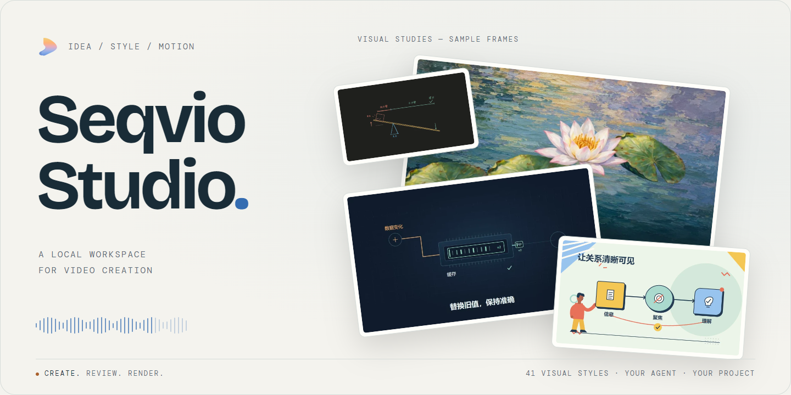
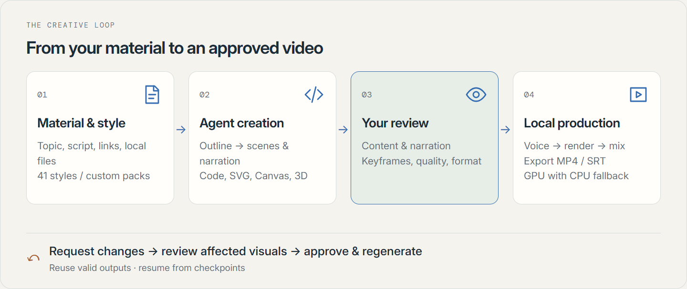
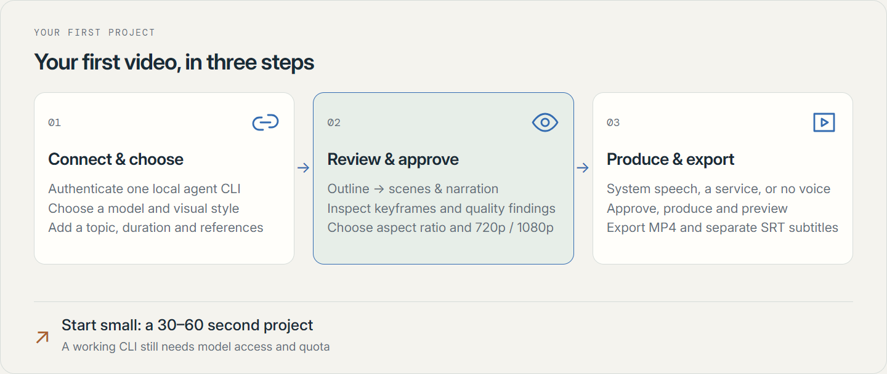
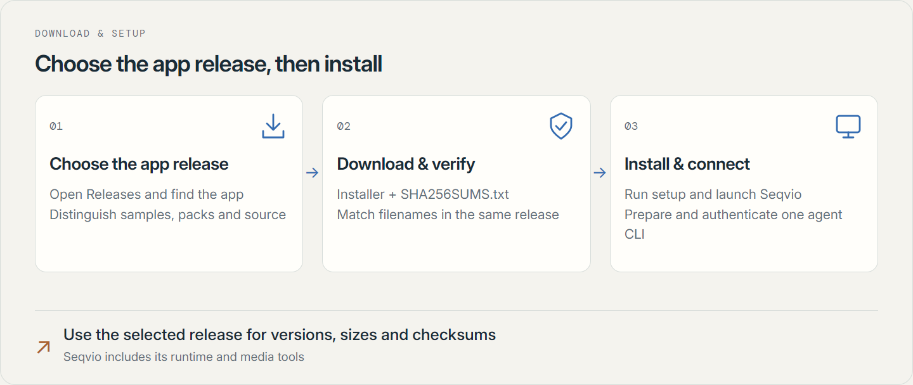
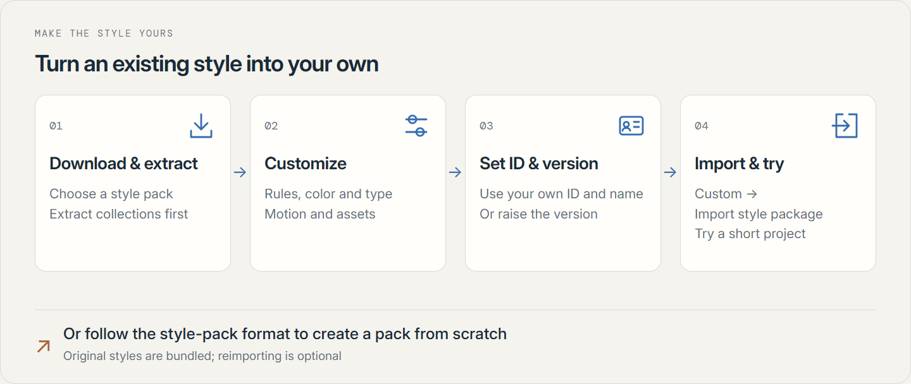

<h1 align="center">Seqvio Studio</h1>

<p align="center"><strong>Make long-form video creation simpler.</strong></p>

<p align="center"><a href="https://github.com/makesynt/seqvio-studio/releases"><strong>Download</strong></a> · <a href="docs/USAGE.en.md">User guide</a> · <a href="docs/STYLE-PACKS.md">Style packs & customization</a> · <a href="README.md">简体中文</a></p>

<picture>
  <source media="(prefers-color-scheme: dark)" srcset="docs/images/readme/hero-dark.png">
  
</picture>


Seqvio Studio is an AI-assisted local video workspace. Connect your own OpenCode, Codex, or Antigravity. Let the agent author visuals and animation, review the outline, scenes, and keyframes, then use Seqvio for narration timing, quality checks, and rendering.

> **Before you begin:** prepare a working local agent CLI and model access. The installer includes the rendering runtime and media tools, not model accounts, subscriptions, or quota.

## Keep control from first idea to final video

<picture>
  <source media="(max-width: 600px) and (prefers-color-scheme: dark)" srcset="docs/images/readme/workflow-en-dark-mobile.png">
  <source media="(max-width: 600px)" srcset="docs/images/readme/workflow-en-light-mobile.png">
  <source media="(prefers-color-scheme: dark)" srcset="docs/images/readme/workflow-en-dark.png">
  
</picture>

<details>
<summary>Text description of the workflow and capabilities</summary>

| Content and visual language | Production and revision |
| --- | --- |
| **Start with your material**<br>Use a topic, script, links, or local references. Establish the structure before scenes and narration. | **Review before production**<br>Inspect keyframes and quality findings, then approve the current content and output settings. |
| **41 built-in styles**<br>Diagrams, whiteboards, kinetic type, collage, and artistic looks, plus custom style packages. | **Change one scene, reuse the rest**<br>Keep valid cached outputs and resume from checkpoints after cancellation or interruption. |
| **Code-driven visuals**<br>Combine text, images, SVG, Canvas, and Three.js into revisable scenes. | **Local production and export**<br>Render scenes, generate narration, and assemble videos. Use suitable GPU codecs with CPU fallback. |

</details>

## Choose your visual language

| Explain complex ideas | Find your visual language |
| :---: | :---: |
| [](https://github.com/makesynt/seqvio-studio/releases/download/style-samples-v1/tech-7390b01c76cdb29c.mp4)<br>**Technical diagrams** · [Watch sample](https://github.com/makesynt/seqvio-studio/releases/download/style-samples-v1/tech-7390b01c76cdb29c.mp4) | [](https://github.com/makesynt/seqvio-studio/releases/download/style-samples-v1/blackboard-aec096e78f7d2298.mp4)<br>**Hand-drawn blackboard** · [Watch sample](https://github.com/makesynt/seqvio-studio/releases/download/style-samples-v1/blackboard-aec096e78f7d2298.mp4) |
| [](https://github.com/makesynt/seqvio-studio/releases/download/style-samples-v1/memphis-ebee7c23dd8c01ad.mp4)<br>**Memphis motion** · [Watch sample](https://github.com/makesynt/seqvio-studio/releases/download/style-samples-v1/memphis-ebee7c23dd8c01ad.mp4) | [](https://github.com/makesynt/seqvio-studio/releases/download/style-samples-v1/monet-ad2802e92ca6c101.mp4)<br>**Monet-inspired color** · [Watch sample](https://github.com/makesynt/seqvio-studio/releases/download/style-samples-v1/monet-ad2802e92ca6c101.mp4) |


Samples illustrate a visual direction. Actual work depends on your topic, references, selected model, and review. [Browse all samples](https://github.com/makesynt/seqvio-studio/releases/tag/style-samples-v1) · [Download style packs](docs/STYLE-PACKS.md)

<details>
<summary>See the actual app: style library</summary>


</details>

## Start in three steps

<picture>
  <source media="(max-width: 600px) and (prefers-color-scheme: dark)" srcset="docs/images/readme/quickstart-en-dark-mobile.png">
  <source media="(max-width: 600px)" srcset="docs/images/readme/quickstart-en-light-mobile.png">
  <source media="(prefers-color-scheme: dark)" srcset="docs/images/readme/quickstart-en-dark.png">
  
</picture>

Try a 30–60 second project first. A connection check only confirms that the CLI starts; model access and quota must also be available. [Read the full walkthrough](docs/USAGE.en.md)

<details>
<summary>Text walkthrough of the three steps</summary>

1. **Connect and choose a style.** Install/authenticate one supported CLI. Select an available model under engine settings (引擎与连接). Supply the topic, audience, target duration, and references, then choose a visual style.
2. **Review and approve.** Check the outline, scenes and narration, and static keyframes. Choose landscape/portrait and 720p/1080p, then approve the current version.
3. **Produce and export.** Choose Windows system speech, a configured voice service, or no voiceover. Produce and preview the result, then export MP4. If the result has subtitles, save them via More project actions → Export subtitles SRT (更多项目操作 → 导出字幕 SRT).

</details>

## Download and install

| Platform | Public distribution status |
| --- | --- |
| Windows x64 | Installer preview available. Check each release for signing status, known issues, and validation scope. |
| macOS / Linux | No validated installers are published. Windows results do not establish support on other platforms. |

<picture>
  <source media="(max-width: 600px) and (prefers-color-scheme: dark)" srcset="docs/images/readme/install-en-dark-mobile.png">
  <source media="(max-width: 600px)" srcset="docs/images/readme/install-en-light-mobile.png">
  <source media="(prefers-color-scheme: dark)" srcset="docs/images/readme/install-en-dark.png">
  
</picture>

<details>
<summary>Text instructions for download and installation</summary>

1. Open [Releases](https://github.com/makesynt/seqvio-studio/releases) and select a **Seqvio Studio application release**. Samples, style packs, and FFmpeg source share the release list, so check what you are downloading.
2. Download the matching installer and **SHA256SUMS.txt** from that release's **Assets**. Verify before installing; filenames, versions, sizes, and checksums live on the release page.
3. Launch the app and configure an agent. Seqvio itself needs no separate Node.js, Python, or FFmpeg installation; follow the chosen CLI's own setup requirements.

</details>

<details>
<summary>Windows checksum command and unsigned builds</summary>

Run in the download directory:

```powershell
Get-FileHash -Algorithm SHA256 .\Seqvio-Studio-*-Setup.exe
```

Match each filename/hash with the same release's checksum list. Unsigned builds may trigger unknown-publisher, SmartScreen, or device-policy blocks. Verify the source and use only options permitted by your system.

</details>

This is a documentation and distribution repository, not the complete application development project. GitHub-generated **Source code ZIP/TAR** files are repository snapshots, not installers.

## Bundled or prepared on demand?

| Included in the Windows installer | Downloaded or configured separately |
| --- | --- |
| Electron/default Chromium renderer; FFmpeg and ffprobe. | Full sample videos, five optional whiteboard fonts, and the optional Chrome backend: downloaded, verified, and cached as needed. |
| Built-in styles, covers, silent loops, and Inter, Noto Sans SC, Virgil, and Long Cang fonts. | OpenCode / Codex / Antigravity CLI and model access. Choose one engine and supply your own authentication/configuration. |
| Windows system speech uses voices installed on your PC; no voiceover is also an option. | Online speech such as MiniMax needs credentials/quota; self-hosted CosyVoice needs a reachable service. |

Completed caches can be reused offline, and the default renderer needs no separate Chrome download. **Local rendering is not offline AI:** model calls, image review, or cloud speech may still need network access. Default export is H.264/AAC MP4; bundled x265 does not add an H.265 export control.

## Style pack downloads and customization

<picture>
  <source media="(max-width: 600px) and (prefers-color-scheme: dark)" srcset="docs/images/readme/customize-en-dark-mobile.png">
  <source media="(max-width: 600px)" srcset="docs/images/readme/customize-en-light-mobile.png">
  <source media="(prefers-color-scheme: dark)" srcset="docs/images/readme/customize-en-dark.png">
  
</picture>

Download a pack, edit its rules, palette, typography, motion, and declared assets, then import it. Or follow the format to create a pack from scratch. The originals are already bundled; importing them again is optional.

Extract collections before importing individual packs. See the [style-pack guide](docs/STYLE-PACKS.md) for the complete format, assets, and version rules.

## Useful details before you begin

<details>
<summary>How do content revisions and project recovery work?</summary>

Describe the changes in the project conversation so the agent can revise the relevant scenes, visuals, or narration. Review the affected content and keyframes again, then confirm, regenerate, and check the video preview. Element editing and manual editing entry points are currently hidden in the interface. Cancellation or interruption preserves checkpoints and valid outputs; reopen the project to continue from saved progress. See the [user guide](docs/USAGE.en.md) for the full workflow.

</details>

<details>
<summary>Where is my data stored, and what goes to a model?</summary>

Projects and outputs are stored locally. References, prompts, style reference images, and review keyframes may be sent to your selected model. Online speech sends narration to the selected service and may incur charges. Supply only material intended for these services. Back up project directories and related assets together.

</details>

<details>
<summary>What are the subtitle, GPU, and offline limits?</summary>

Subtitle/phrase timing is estimated, not word-level forced alignment. SRT subtitles are exported separately, not automatically burned into the picture. GPU use depends on hardware, drivers, the task, and measured speed; initial probes add overhead, and CPU may be the better choice. Cache full samples and optional fonts before using them offline.

</details>

## Licenses and feedback

FFmpeg/ffprobe are bundled as separate tools under GPL-3.0-or-later. The in-app third-party licenses/source window (第三方许可与源码) provides their local notices and matching source links. Follow bundled notices for other components. Use the selected application release notes for corresponding source and build records.

Report problems in [Issues](https://github.com/makesynt/seqvio-studio/issues), including the app version, OS, engine/model, and reproduction steps. Remove credentials and private material before posting.

## References and acknowledgements

Seqvio Studio builds on [Seqvio](https://github.com/makesynt/seqvio), maintained by the same author, for scene composition, timing, quality checks, and rendering.

Parts of the art-style and animation implementation draw inspiration from the design and implementation of [huashu-art-motion](https://github.com/alchaincyf/huashu-art-motion) by alchaincyf (花叔·花生). Thanks to the author for sharing their work as open source.

<details>
<summary>More open-source projects and their roles</summary>

| Project | Role |
| --- | --- |
| [Electron](https://github.com/electron/electron) / [Chromium](https://www.chromium.org/) | Desktop runtime and browser rendering foundation. |
| [React](https://github.com/react/react) / [Three.js](https://github.com/mrdoob/three.js) | Authored scene components and local 3D visuals. |
| [Rough.js](https://github.com/rough-stuff/rough) | Sketch-style strokes and whiteboard drawing. |
| [Excalidraw](https://github.com/excalidraw/excalidraw) | Whiteboard visual references and the Virgil font; the full Excalidraw editor is not embedded. |
| [FFmpeg](https://ffmpeg.org/) | Media probing, audio/video codecs, mixing, and assembly. |
| [Puppeteer](https://github.com/puppeteer/puppeteer) / [esbuild](https://github.com/evanw/esbuild) | Browser automation and scene compilation/bundling. |
| [Shiki](https://github.com/shikijs/shiki) / [Dagre](https://github.com/dagrejs/dagre) | Syntax highlighting and graph layout. |
| [Acorn](https://github.com/acornjs/acorn) / [Ajv](https://github.com/ajv-validator/ajv) / [yauzl](https://github.com/thejoshwolfe/yauzl) | Syntax parsing, data validation, and ZIP reading. |
| [OpenCode](https://github.com/anomalyco/opencode) / [Codex CLI](https://github.com/openai/codex) | Optional local creation-agent integrations; install and configure them separately. |
| [Inter](https://github.com/rsms/inter) / [Noto fonts](https://github.com/notofonts) | UI and multilingual typography. |

</details>

Fonts, assets, and third-party components retain their own licenses. These acknowledgements do not replace the notices distributed with each release.

