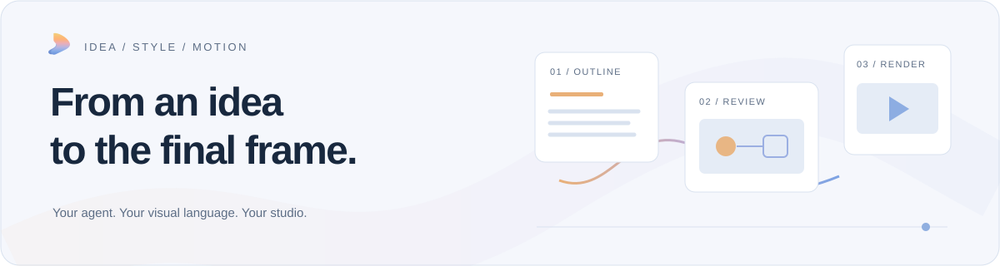
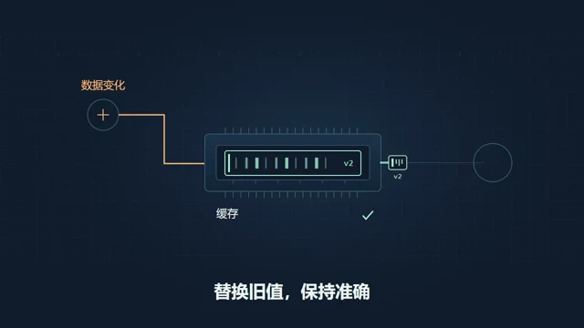
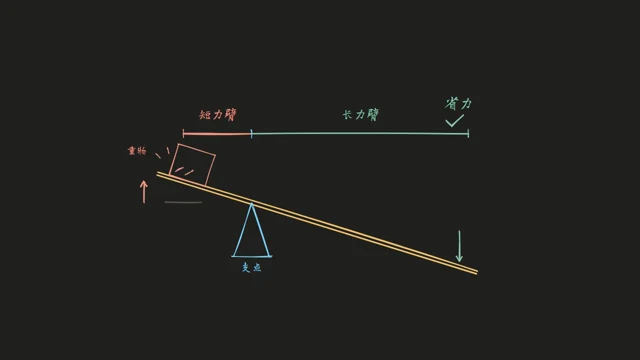

<h1 align="center">Seqvio Studio</h1>

<p align="center"><strong>长视频创作，化繁为简。</strong><br>把主题与资料，变成可审阅、可修改的视频。</p>

<p align="center"><a href="https://github.com/makesynt/seqvio-studio/releases"><strong>下载安装</strong></a> · <a href="docs/USAGE.zh-CN.md">使用指南</a> · <a href="docs/STYLE-PACKS.md">风格包与自定义</a> · <a href="README.en.md">English</a></p>

<picture>
  <source media="(prefers-color-scheme: dark)" srcset="docs/images/readme-hero-dark.svg">
  
</picture>


Seqvio Studio 是一款 AI 辅助的本地视频创作工作台。连接你自己的 OpenCode、Codex 或 Antigravity，让 Agent 根据主题与风格编写画面和动画，在草案、分镜和关键帧阶段确认方向，再由 Seqvio 完成配音映射、质检与渲染。

> **开始前**：请准备一个可用的本机 Agent CLI 及模型权限。安装包包含渲染运行时和媒体工具，不包含模型账号、订阅或额度。

## 从内容到成片，保留创作的控制权

| 内容与风格 | 制作与修改 |
| --- | --- |
| **资料驱动的创作**<br>从主题、稿件、链接或本地资料开始，先确定结构，再规划分镜与旁白。 | **先看画面，再制作**<br>审阅关键帧和质检提醒，确认当前内容与输出规格。 |
| **41 套内置视觉风格**<br>图解、白板、动态文字、拼贴与艺术表达；支持自定义风格包。 | **修改一镜，复用其余**<br>保留有效缓存，取消或中断后按检查点继续。 |
| **代码驱动的画面**<br>组合文字、图片、SVG、Canvas 与 Three.js，形成可修改的视觉表达。 | **本地制作与导出**<br>完成场景渲染、配音与视频合成；适合时使用 GPU，并保留 CPU 回退。 |

## 选择你的视觉语言

| 解释复杂概念 | 换一种视觉表达 |
| :---: | :---: |
| [](https://github.com/makesynt/seqvio-studio/releases/download/style-samples-v1/tech-7390b01c76cdb29c.mp4)<br>**技术图解** · [观看样片](https://github.com/makesynt/seqvio-studio/releases/download/style-samples-v1/tech-7390b01c76cdb29c.mp4) | [](https://github.com/makesynt/seqvio-studio/releases/download/style-samples-v1/blackboard-aec096e78f7d2298.mp4)<br>**手绘黑板** · [观看样片](https://github.com/makesynt/seqvio-studio/releases/download/style-samples-v1/blackboard-aec096e78f7d2298.mp4) |
| [](https://github.com/makesynt/seqvio-studio/releases/download/style-samples-v1/memphis-ebee7c23dd8c01ad.mp4)<br>**孟菲斯** · [观看样片](https://github.com/makesynt/seqvio-studio/releases/download/style-samples-v1/memphis-ebee7c23dd8c01ad.mp4) | [](https://github.com/makesynt/seqvio-studio/releases/download/style-samples-v1/monet-ad2802e92ca6c101.mp4)<br>**莫奈光色** · [观看样片](https://github.com/makesynt/seqvio-studio/releases/download/style-samples-v1/monet-ad2802e92ca6c101.mp4) |


样片展示风格方向，实际作品由主题、资料、所选模型与审阅修改共同决定。[浏览全部样片](https://github.com/makesynt/seqvio-studio/releases/tag/style-samples-v1) · [下载风格包](docs/STYLE-PACKS.md)

<details>
<summary>查看应用实际界面：风格库</summary>


</details>

## 三步开始第一次创作

1. **连接与选风格** — 安装并登录一个受支持的 CLI，在“设置 → 引擎与连接”选择可用模型；输入主题、受众、目标时长和资料，选择视觉风格。
2. **审阅与确认** — 依次检查制作草案、分镜与旁白、静态关键帧。选择横屏或竖屏、720p 或 1080p，完成当前版本确认。
3. **制作与导出** — 选择 Windows 系统语音、已配置的语音服务或无配音，制作并预览成片，导出 MP4 与独立 SRT/VTT 字幕。

建议先做一个 30–60 秒的小项目。连接检测只验证 CLI 能否启动，模型访问和额度仍需可用。[查看完整操作步骤](docs/USAGE.zh-CN.md)

## 下载与安装

| 平台 | 公开发行状态 |
| --- | --- |
| Windows x64 | 已提供安装测试版；查看各版本的签名状态、已知问题与验证范围。 |
| macOS / Linux | 尚未提供已验收的安装包；不将 Windows 验证结果视为其他平台已验证。 |

1. 打开 [Releases](https://github.com/makesynt/seqvio-studio/releases)，选择 **Seqvio Studio 应用发行版**。同一列表也有风格包、样片和 FFmpeg 源码，下载时请区分。
2. 从该版本 **Assets** 下载适合设备的安装包与 **SHA256SUMS.txt**，核对后安装。版本、大小和校验值均以该发布页为准。
3. 启动应用并配置 Agent。Seqvio 安装版本身不需要另装 Node.js、Python 或 FFmpeg；所选 CLI 的安装要求以其官方说明为准。

<details>
<summary>Windows 校验命令与未签名版本说明</summary>

在下载目录执行：

```powershell
Get-FileHash -Algorithm SHA256 .\Seqvio-Studio-*-Setup.exe
```

按文件名与同一 Release 的校验清单核对。未签名版本可能触发未知发布者、SmartScreen 或设备策略拦截；确认来源后，仅使用系统允许的方式继续。

</details>

本仓库用于产品文档与公开分发，不包含完整应用开发工程。GitHub 自动生成的 **Source code ZIP/TAR** 是仓库快照，不是安装包。

## 随包提供，还是按需准备？

| 随 Windows 安装包提供 | 首次使用或由你准备 |
| --- | --- |
| Electron 与默认 Chromium 渲染后端；FFmpeg / ffprobe。 | 完整风格样片、其他五款白板字体和可选 Chrome：按需下载、校验并缓存。 |
| 内置风格、封面、静音短循环；Inter、Noto Sans SC、Virgil 和 Long Cang 字体。 | OpenCode / Codex / Antigravity CLI 及可用模型；任选一个引擎，自行完成登录与服务配置。 |
| Windows 系统语音可使用本机已有音色；也可选择无配音。 | MiniMax 等在线配音需对应凭据与额度；自托管 CosyVoice 需可访问的服务。 |

已缓存资源可离线复用；默认本地渲染无需另外下载 Chrome。**本地渲染不等于 AI 离线**：模型调用、审图或云端配音可能仍需网络。当前默认导出 H.264/AAC MP4；包含 x265 不等于界面提供 H.265 导出选项。

## 风格包下载与自定义

下载现有包，修改规则、配色、排版、动效和声明的资源后导入；也可参考格式从头制作自己的包。安装版已内置原风格，通常无需重复导入。

**解压 → 自定义 → 设置自己的 ID/名称或增加版本 → 导入并试做。** 全量合集须先解压，再逐个导入单包。完整格式、资源与版本规则见[风格包指南](docs/STYLE-PACKS.md)。

## 使用前值得了解

<details>
<summary>如何修改内容与恢复项目？</summary>

通过项目会话说明要修改的内容，由 Agent 调整相关分镜、画面或旁白。修改后重新审阅受影响的内容与关键帧，确认后重新制作并检查视频预览。当前界面已隐藏元素编辑与手动编辑入口。取消或中断会保留检查点及有效产物；重新打开项目后，可基于已保存的进度继续制作。更多流程见[使用指南](docs/USAGE.zh-CN.md)。

</details>

<details>
<summary>资料存在哪里，哪些内容会交给模型？</summary>

项目和产物保存在本机。创作资料、提示词、风格参考图和审图关键帧可能交给所选模型；在线配音将旁白交给对应服务，并可能计费。只提供准备交给这些服务处理的内容。备份时同时保留项目目录与素材。

</details>

<details>
<summary>字幕、GPU 和离线使用有哪些边界？</summary>

字幕与句内短语时间目前为估算，不是逐词强制对齐；SRT/VTT 为独立文件，不代表自动烧录。GPU 由设备、驱动、任务与实测速度决定，首次探测有额外开销，使用 CPU 可能是更合适的选择。完整样片和可选字体需先缓存才能离线使用。

</details>

## 许可与反馈

FFmpeg/ffprobe 作为独立工具随包提供，许可为 GPL-3.0-or-later。应用内“设置 → 关于与诊断 → 第三方许可与源码”提供其本地许可与对应源码入口；其他组件按随包版权与许可说明使用。对应源码与构建资料以所选应用发行版的发布说明为准。

遇到问题可提交 [Issue](https://github.com/makesynt/seqvio-studio/issues)，附应用版本、系统、引擎/模型和复现步骤，先移除密钥与私人资料。

## 参考项目与致谢

Seqvio Studio 的场景、时序、质检与渲染能力基于同样由本项目作者维护的 [Seqvio](https://github.com/makesynt/seqvio)。

艺术风格与动画相关实现参考借鉴了 [huashu-art-motion](https://github.com/alchaincyf/huashu-art-motion)（alchaincyf / 花叔·花生）的部分设计与实现，感谢作者的开源分享。

<details>
<summary>更多开源项目与用途</summary>

| 项目 | 用途 |
| --- | --- |
| [Electron](https://github.com/electron/electron) / [Chromium](https://www.chromium.org/) | 桌面运行时及默认浏览器渲染基础。 |
| [React](https://github.com/react/react) / [Three.js](https://github.com/mrdoob/three.js) | 代码场景组件与本地三维画面。 |
| [Rough.js](https://github.com/rough-stuff/rough) | 手绘线条与白板绘图。 |
| [Excalidraw](https://github.com/excalidraw/excalidraw) | 白板视觉与 Virgil 字体来源；并非嵌入完整 Excalidraw 编辑器。 |
| [FFmpeg](https://ffmpeg.org/) | 媒体探测、音视频编解码、混音和合成。 |
| [Puppeteer](https://github.com/puppeteer/puppeteer) / [esbuild](https://github.com/evanw/esbuild) | 浏览器自动化及场景编译打包。 |
| [Shiki](https://github.com/shikijs/shiki) / [Dagre](https://github.com/dagrejs/dagre) | 代码高亮与图表布局。 |
| [Acorn](https://github.com/acornjs/acorn) / [Ajv](https://github.com/ajv-validator/ajv) / [yauzl](https://github.com/thejoshwolfe/yauzl) | 语法解析、数据校验与 ZIP 读取。 |
| [OpenCode](https://github.com/anomalyco/opencode) / [Codex CLI](https://github.com/openai/codex) | 可选的本机创作 Agent 接入；需自行安装和配置。 |
| [Inter](https://github.com/rsms/inter) / [Noto fonts](https://github.com/notofonts) | 界面与多语言排版字体。 |

</details>

字体、素材和第三方组件保留各自许可。以上致谢不替代随发行版提供的完整版权与许可说明。

