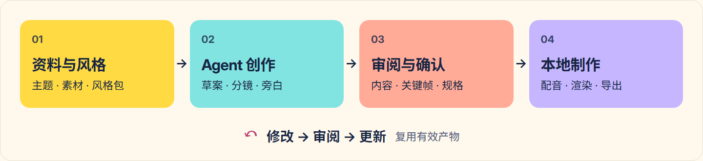
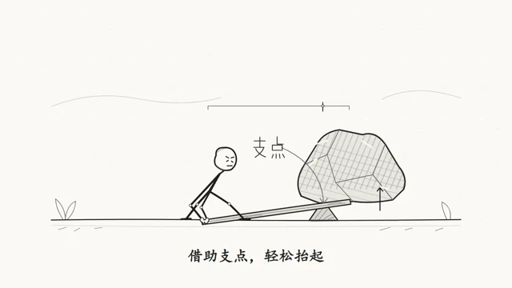
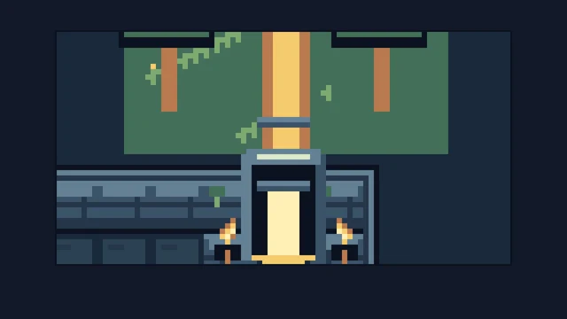

<h1 align="center">Seqvio Studio</h1>

<p align="center"><strong>长视频创作，化繁为简。</strong></p>

<p align="center"><a href="https://github.com/makesynt/seqvio-studio/releases"><strong>下载安装</strong></a> · <a href="docs/USAGE.zh-CN.md">使用指南</a> · <a href="docs/STYLE-PACKS.md">风格包与自定义</a> · <a href="README.en.md">English</a></p>

<picture>
  <source media="(prefers-color-scheme: dark)" srcset="docs/images/readme/hero-dark.png">
  
</picture>

Seqvio Studio 是一款 AI 辅助的本地视频创作工作台，内置 41 套视觉风格。连接 OpenCode、Codex 或 Antigravity 编写画面与动画，审阅关键帧后完成配音、质检和视频导出。

## 从内容到成片，保留创作的控制权

<picture>
  <source media="(max-width: 600px) and (prefers-color-scheme: dark)" srcset="docs/images/readme/workflow-zh-dark-mobile.png">
  <source media="(max-width: 600px)" srcset="docs/images/readme/workflow-zh-light-mobile.png">
  <source media="(prefers-color-scheme: dark)" srcset="docs/images/readme/workflow-zh-dark.png">
  
</picture>

在项目会话中提出修改，重新审阅受影响的画面后再制作；中断后可从已保存的进度继续。[查看使用指南](docs/USAGE.zh-CN.md)

## 精选风格

六种风格合集，保留原样片音轨。

https://github.com/user-attachments/assets/3c18f0a6-96c7-45c5-8655-aabd8625d4b1

<table>
<tr>
<td align="center"><a href="https://github.com/makesynt/seqvio-studio/releases/download/style-samples-v1/motion-stickman-d1d73606e2309436.mp4"></a><br><strong>火柴人动画</strong> · <a href="https://github.com/makesynt/seqvio-studio/releases/download/style-samples-v1/motion-stickman-d1d73606e2309436.mp4">完整样片</a></td>
<td align="center"><a href="https://github.com/makesynt/seqvio-studio/releases/download/style-samples-v1/bauhaus-041e1caad83c2189.mp4"></a><br><strong>包豪斯几何</strong> · <a href="https://github.com/makesynt/seqvio-studio/releases/download/style-samples-v1/bauhaus-041e1caad83c2189.mp4">完整样片</a></td>
</tr>
<tr>
<td align="center"><a href="https://github.com/makesynt/seqvio-studio/releases/download/style-samples-v1/kurzgesagt-flat-09edc2b324906276.mp4"></a><br><strong>扁平科普</strong> · <a href="https://github.com/makesynt/seqvio-studio/releases/download/style-samples-v1/kurzgesagt-flat-09edc2b324906276.mp4">完整样片</a></td>
<td align="center"><a href="https://github.com/makesynt/seqvio-studio/releases/download/style-samples-v1/blackboard-aec096e78f7d2298.mp4"></a><br><strong>手绘黑板</strong> · <a href="https://github.com/makesynt/seqvio-studio/releases/download/style-samples-v1/blackboard-aec096e78f7d2298.mp4">完整样片</a></td>
</tr>
<tr>
<td align="center"><a href="https://github.com/makesynt/seqvio-studio/releases/download/style-samples-v1/pixel-1f26cb412eb9dc1f.mp4"></a><br><strong>复古像素</strong> · <a href="https://github.com/makesynt/seqvio-studio/releases/download/style-samples-v1/pixel-1f26cb412eb9dc1f.mp4">完整样片</a></td>
<td align="center"><a href="https://github.com/makesynt/seqvio-studio/releases/download/style-samples-v1/cinematic-light-38aa59501dc45dd9.mp4"></a><br><strong>动画电影</strong> · <a href="https://github.com/makesynt/seqvio-studio/releases/download/style-samples-v1/cinematic-light-38aa59501dc45dd9.mp4">完整样片</a></td>
</tr>
</table>

[浏览全部样片](https://github.com/makesynt/seqvio-studio/releases/tag/style-samples-v1) · [下载风格包](docs/STYLE-PACKS.md) · [样片与音乐署名](docs/SHOWCASE-CREDITS.md)

<details>
<summary>查看应用实际界面：风格库</summary>


</details>

## 下载与安装

目前提供 **Windows x64 测试版**；macOS、Linux 安装包尚未发布。

1. 打开 [Releases](https://github.com/makesynt/seqvio-studio/releases)，选择 **Seqvio Studio 应用发行版**，下载 Assets 中的安装包和 `SHA256SUMS.txt`，核对后安装。不要下载自动生成的 Source code 压缩包。
2. 安装并登录一个支持的 Agent CLI（OpenCode、Codex 或 Antigravity），准备可用的模型权限与额度。
3. 启动应用，配置 Agent，新建项目并选择风格，按提示完成创作与审阅。[详细步骤](docs/USAGE.zh-CN.md)

<details>
<summary>校验安装包</summary>

在下载目录执行，将结果与同一发布页的 `SHA256SUMS.txt` 核对：

```powershell
Get-FileHash -Algorithm SHA256 .\Seqvio-Studio-*-Setup.exe
```

未签名版本可能触发 Windows 安全提示，签名状态见发布说明。

</details>

安装包已含渲染运行时、FFmpeg/ffprobe、内置风格和默认字体。完整样片、额外字体与可选 Chrome 按需下载并缓存，可在缓存后离线使用。Agent 模型和在线配音需另行配置，通常需要网络。

## 风格包下载与自定义

内置风格可直接使用。需要定制时：

1. 从[风格包发布页](https://github.com/makesynt/seqvio-studio/releases/tag/style-packs-v1)下载单包或合集；合集须先解压，取出所需的单包 ZIP。
2. 解压单包，修改规则、配色、排版、动效或资源，也可参考格式制作自己的风格包。
3. 按[风格包指南](docs/STYLE-PACKS.md)设置 ID 与版本，重新打包，通过应用的“风格库 → 我的风格 → 导入风格包”导入。

## 数据与隐私

项目与产物保存在本机；创作资料、提示词和审图画面可能发送给所选模型，在线配音会将旁白发送给对应服务。备份时请同时保留项目目录与素材。

## 许可与反馈

FFmpeg/ffprobe 随包提供，采用 GPL-3.0-or-later 许可。许可与对应源码入口见“设置 → 关于与诊断 → 第三方许可与源码”及应用发布说明；其他组件遵循随包许可。

问题请提交至 [Issues](https://github.com/makesynt/seqvio-studio/issues)，附版本、系统与复现步骤，并移除密钥和私人资料。

## 参考项目与致谢

Seqvio Studio 的场景、时序、质检与渲染能力基于同样由本项目作者维护的 [Seqvio](https://github.com/makesynt/seqvio)。

艺术风格与动画相关实现参考借鉴了 [huashu-art-motion](https://github.com/alchaincyf/huashu-art-motion)（alchaincyf / 花叔·花生）的部分设计与实现，感谢作者的开源分享。

<details>
<summary>更多开源项目与用途</summary>

| 项目 | 用途 |
| --- | --- |
| [Electron](https://github.com/electron/electron) / [Chromium](https://www.chromium.org/) | 桌面运行时及默认浏览器渲染基础。 |
| [React](https://github.com/react/react) / [Three.js](https://github.com/mrdoob/three.js) | 代码场景组件与本地三维画面。 |
| [Rough.js](https://github.com/rough-stuff/rough) | 手绘线条与白板绘图。 |
| [Excalidraw](https://github.com/excalidraw/excalidraw) | 白板视觉与 Virgil 字体来源。 |
| [FFmpeg](https://ffmpeg.org/) | 媒体探测、音视频编解码、混音和合成。 |
| [Puppeteer](https://github.com/puppeteer/puppeteer) / [esbuild](https://github.com/evanw/esbuild) | 浏览器自动化及场景编译打包。 |
| [Shiki](https://github.com/shikijs/shiki) / [Dagre](https://github.com/dagrejs/dagre) | 代码高亮与图表布局。 |
| [Acorn](https://github.com/acornjs/acorn) / [Ajv](https://github.com/ajv-validator/ajv) / [yauzl](https://github.com/thejoshwolfe/yauzl) | 语法解析、数据校验与 ZIP 读取。 |
| [OpenCode](https://github.com/anomalyco/opencode) / [Codex CLI](https://github.com/openai/codex) | 可选的本机创作 Agent 接入；需自行安装和配置。 |
| [Inter](https://github.com/rsms/inter) / [Noto fonts](https://github.com/notofonts) | 界面与多语言排版字体。 |

</details>

字体、素材和第三方组件保留各自许可。以上致谢不替代随发行版提供的完整版权与许可说明。
