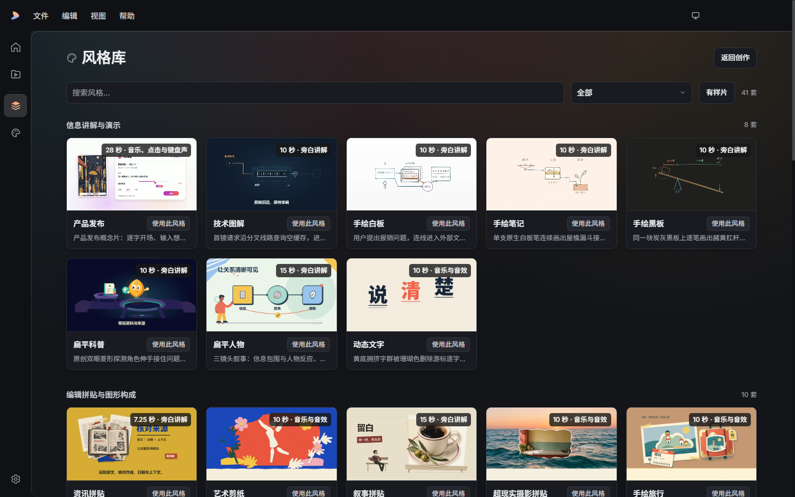

# Seqvio Studio

**长视频创作，化繁为简。**

简体中文 · [English](README.en.md)

[下载安装](https://github.com/makesynt/seqvio-studio/releases) · [完整使用指南](docs/USAGE.zh-CN.md) · [风格包下载](docs/STYLE-PACKS.md) · [风格样片](https://github.com/makesynt/seqvio-studio/releases/tag/style-samples-v1)

Seqvio Studio 是一款本地桌面视频创作工作台。输入主题、资料或完整稿件，连接你自己的 OpenCode、Codex 或 Antigravity，逐步完成内容规划、分镜与旁白、画面编写、关键帧审阅、配音和视频导出。

Agent 按所选风格编写画面和动画，Seqvio 引擎负责场景编译、配音时间映射、质检与渲染。你可以在关键阶段确认内容，制作后继续修改单个场景，并复用仍然有效的产物。



## 主要功能

- **从资料到视频**：用主题、粘贴的稿件、链接或本地资料开始，先确认制作草案，再审阅分镜与旁白。
- **41 套内置风格**：技术图解、手绘白板、手绘笔记、黑板、扁平科普、动态文字、拼贴等；支持导入和导出风格 Skill 包，也可从完成的视频提炼个人风格。
- **代码驱动的画面与动画**：组合文字、图片、DOM、SVG、Canvas 和 Three.js，支持本地三维画面，不依赖生成式视频模型完成逐帧渲染。
- **配音与字幕**：Windows 系统语音可本地使用；可配置 MiniMax、自托管 CosyVoice 等语音服务，也可不配音。导出 MP4 和独立 SRT/VTT 字幕。
- **可审阅、可恢复的制作流程**：生成关键帧、检查画面，再确认制作；取消或中断后保留检查点，修改时增量制作。
- **元素与时间线编辑**：调整受支持的文字、图片、SVG、二维图层和动画；剪辑工作台提供裁剪、分割、重排、配乐、音效、文字及图片覆盖图层。
- **本地渲染与自适应 GPU**：默认复用 Electron 的 Chromium；适合时选择更快的可用 GPU 编解码路径，失败回退 CPU。可切换到 Chrome 兼容后端。

## 下载与安装

安装包统一在 [GitHub Releases](https://github.com/makesynt/seqvio-studio/releases) 发布。请在列表中选择 **Seqvio Studio 应用版本**，不要将样片、风格包或 FFmpeg 源码发布当作安装包。测试版本会标记为 **Pre-release**。

1. 打开所选应用版本的发布页，阅读系统、CPU 架构、签名状态及已知问题。
2. 在 **Assets** 中下载与设备匹配的安装包，以及同一发布页的 **SHA256SUMS.txt**。具体文件名、版本、大小和校验值以该发布页为准。
3. 以下为 Windows 校验示例：在下载目录执行命令，将结果按文件名与校验清单核对，再运行安装程序。
4. 完成安装后启动 **Seqvio Studio**，按下方步骤配置创作引擎。其他平台的安装方式以对应发行说明为准。

```powershell
Get-FileHash -Algorithm SHA256 .\Seqvio-Studio-*-Setup.exe
```

未签名版本可能显示未知发布者或 SmartScreen 提示，部分设备策略会阻止运行。确认下载来源和校验结果后，使用系统允许的方式继续。详见[安装与常见问题](docs/USAGE.zh-CN.md#安装与首次启动)。

GitHub 自动生成的 **Source code (zip/tar.gz)** 是本分发仓库的快照，不是安装包。本仓库提供产品文档、安装版本、样片和第三方构建资料；不包含完整桌面应用开发工程，不能通过克隆本仓库再执行 `npm install` 启动应用。

## 安装包包含什么

| 项目 | 提供方式 |
| --- | --- |
| 桌面应用、Electron 与默认 Chromium 渲染后端 | 随安装包提供 |
| FFmpeg 与 ffprobe | 随 Windows 安装包提供，可离线使用 |
| 41 套风格、封面与静音短循环预览 | 随安装包提供 |
| 界面字体 Inter、Noto Sans SC；默认白板字体 Virgil、Long Cang | 随安装包提供，可离线使用 |
| 完整风格样片 | 首次预览时从本仓库 GitHub Releases 下载，校验并缓存 |
| 小赖、悠哉、霞鹜文楷轻便版、刘建毛草、志莽行 | 首次使用时下载并缓存 |
| 可选 Chrome 兼容渲染后端 | 使用时按需准备，默认渲染无需单独安装 Chrome |
| OpenCode / Codex / Antigravity CLI、模型账号与额度 | 用户自行安装并配置，任选一个可用引擎 |
| 云端配音或自托管 CosyVoice | 用户自行准备服务及凭据；Windows 系统配音无需云服务 |

随包媒体工具包含 x265、Windows GPU 编解码及多种音频库。**当前导出界面仍以 H.264/AAC MP4 为默认输出**，包含 x265 不代表增加了 H.265 导出选项。GPU 是否启用取决于设备、驱动及实际速度，首次探测有额外开销。

### 风格包下载与自定义

从[风格包目录与格式说明](docs/STYLE-PACKS.md)下载现有风格包，即可解压修改规则、配色、排版、动效及声明的资源，再导入为自己的风格；也可参考包格式，从头制作个人风格包。安装版已内置原风格，无需为正常使用而重复导入。

自定义后使用自己的 ID 与名称；保留原 ID 时，每次修改内容都应增加版本号。将单个包压缩为 ZIP，在“自定义 → 导入风格包”导入。全量合集先解压，再逐个导入其中的风格 ZIP。目录说明包含必需文件、配置字段、资源声明和版本冲突处理。

## 第一次制作视频

1. **配置引擎**：先在本机安装并登录一个受支持的 CLI；打开 **设置 → 引擎与连接**，选择引擎和可用模型，执行“检测连接”。检测成功仅表示 CLI 可启动，还需确保模型可访问且有额度。
2. **给出创作说明**：在首页输入主题、受众、目标时长和重点，添加需要的资料，选择视觉风格并开始创作。
3. **确认制作草案**：检查核心观点、章节结构和时长预算，可通过会话修改后再确认。
4. **审阅分镜与旁白**：逐镜检查旁白、画面意图和步骤；在“风格与配音”中选择声音或无配音。
5. **审阅关键帧**：生成静态画面，选择横屏/竖屏、720p/1080p，检查更新后的预览及质检提醒，并完成整体确认。
6. **制作与导出**：生成配音和场景视频，预览合成结果，再导出 MP4 与所需字幕文件。
7. **继续修改**：在创作台修改单镜，或使用“元素编辑”“时间线剪辑”；重新检查受影响画面，制作更新版本。

第一次可用 30–60 秒的小项目熟悉流程。完整操作、示例创作说明、配音设置、缓存和恢复见[中文使用指南](docs/USAGE.zh-CN.md)。

## 离线使用与数据

下载完成的样片和可选字体可从缓存离线使用；随包字体、媒体工具以及已有素材的本地渲染无需联网。样片下载支持校验、断点续传和重试，可在预览中清理单个样片，或在 **设置 → 存储** 清理样片缓存。

本地渲染不等于模型离线：AI 创作使用所选 CLI 配置的模型服务；云端配音也需要网络。创作资料、提示词、风格参考图及审图关键帧可能作为任务输入交给所选模型；旁白会交给所选在线配音服务。请按自己的数据和费用要求选择服务。项目与制作产物保存在本机，备份时应同时保留项目文件及相关素材。

## 许可、源码与反馈

安装后的 **设置 → 关于与诊断 → 第三方许可与源码** 提供本地许可及源码入口。FFmpeg/ffprobe 以独立工具随包分发，许可为 GPL-3.0-or-later；对应源码、依赖和构建记录的入口以所选版本的发布说明及应用内链接为准，也可浏览[本仓库 Releases](https://github.com/makesynt/seqvio-studio/releases)。其他第三方组件遵循各自许可证。

反馈问题请使用 [Issues](https://github.com/makesynt/seqvio-studio/issues)，附应用版本、操作系统、所选引擎和复现步骤；提交前移除密钥和私人资料。各发行版本的验证范围、已知问题和平台支持以其发布说明为准。

## 参考项目与致谢

感谢以下开源项目及其贡献者。它们为 Seqvio Studio 提供了引擎、风格参考、运行时及基础能力：

| 项目 | 在本项目中的作用 |
| --- | --- |
| [Seqvio](https://github.com/makesynt/seqvio) | 场景协议、旁白时间映射、质检与渲染引擎。 |
| [huashu-art-motion](https://github.com/alchaincyf/huashu-art-motion) | 艺术风格配方、动画语法及视觉表达参考；感谢 alchaincyf / 花叔·花生。 |
| [Electron](https://github.com/electron/electron) / [Chromium](https://www.chromium.org/) | 桌面运行时及默认浏览器渲染基础。 |
| [React](https://github.com/react/react) / [Three.js](https://github.com/mrdoob/three.js) | 界面、代码场景和本地三维画面。 |
| [Rough.js](https://github.com/rough-stuff/rough) | 手绘线条与白板绘图。 |
| [Excalidraw](https://github.com/excalidraw/excalidraw) | 白板视觉与 Virgil 字体来源；并非嵌入完整 Excalidraw 编辑器。 |
| [FFmpeg](https://ffmpeg.org/) | 媒体探测、音视频编解码、混音和合成。 |
| [Puppeteer](https://github.com/puppeteer/puppeteer) / [esbuild](https://github.com/evanw/esbuild) | 浏览器自动化及场景编译打包。 |
| [Shiki](https://github.com/shikijs/shiki) / [Dagre](https://github.com/dagrejs/dagre) | 代码高亮与图表布局。 |
| [Acorn](https://github.com/acornjs/acorn) / [Ajv](https://github.com/ajv-validator/ajv) / [yauzl](https://github.com/thejoshwolfe/yauzl) | 语法解析、数据校验与 ZIP 读取。 |
| [OpenCode](https://github.com/anomalyco/opencode) / [Codex CLI](https://github.com/openai/codex) | 可选的本机创作 Agent 接入；需自行安装和配置。 |
| [Inter](https://github.com/rsms/inter) / [Noto fonts](https://github.com/notofonts) | 界面与多语言排版字体。 |

以上为主要项目致谢，不是完整依赖或许可清单；风格素材、字体和其他第三方内容遵循各自许可证，具体版权与许可见相应发行版随附说明。
